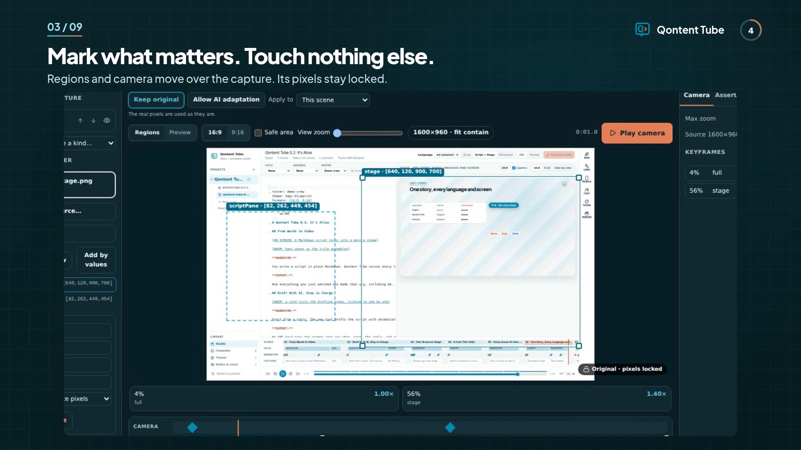
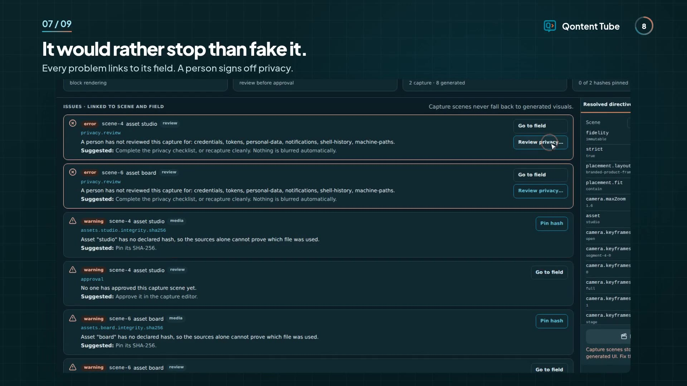
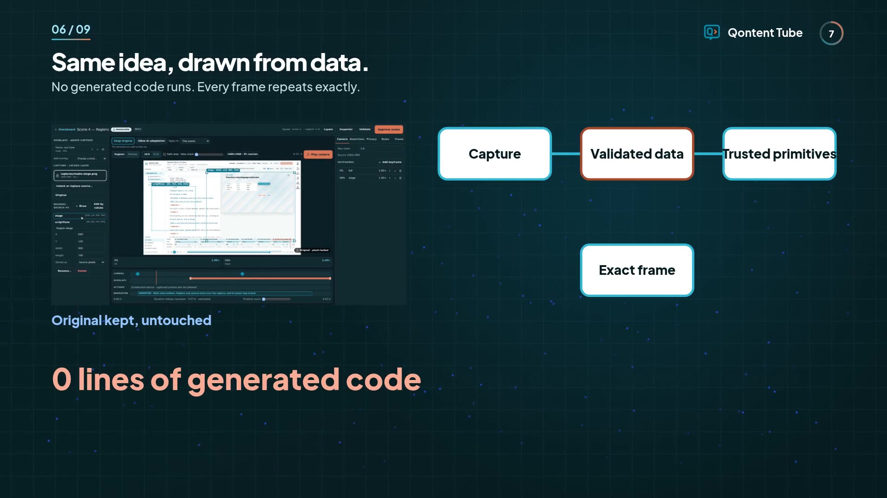
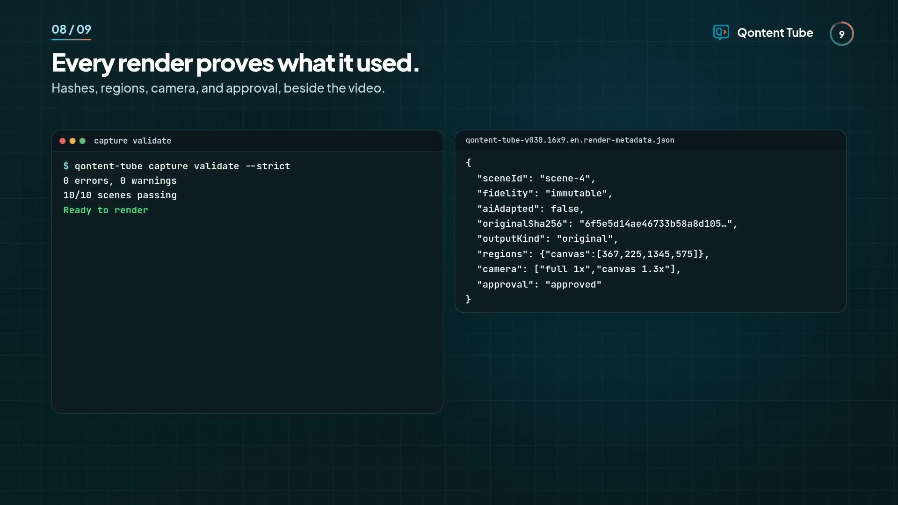

Ask AI for a product demo and you get a video of a product that doesn't exist. The screen looks plausible, but it isn't yours. You can't say which build it shows, and nobody can check it.

Qontent Tube 0.3 starts from the other end. **Your real screenshots and recordings stay exactly as captured, and animation does the explaining around them.**

**We made our launch video this way.** It's the app recording itself, on the project that produced the video. You can even see the film inside its own preview.

<video
  controls
  preload="metadata"
  poster="/img/v030/launch-poster.jpg"
  style={{ width: "100%", borderRadius: 12 }}
>
  <source src="/video/qontent-tube-v030.16x9.en.mp4" type="video/mp4" />
</video>

{/* truncate */}

The animated scene didn't need an API key. Here's what we did on purpose, so you can judge it fairly:

- **when there's no narration.** The video uses headlines and music, and timing comes from word count. **Add a voice** and the timing follows it.
- **The recordings are sped up** 1.4× to 2.3× before import, to fit each scene.
- **The recording and review were scripted** so we could repeat them. That includes the on-screen pointer, which our script draws, and the privacy sign-off, since the footage shows only a demo project. The same steps work by hand in the app.
- **The music is synthesized**, not licensed.

## Dogfood our demos

I created the launch video using Qontent Tube 0.3 itself, capturing our real screens and animating around them. This helped us spot issues that wouldn't appear in a purely AI-generated demo.

That's why we dogfood our own demos, ensuring that what we present is faithful to reality.

## Pixels you can trust

Import a screenshot or recording, and it's verified from its bytes and hashed. Then direct it: draw named regions, move the camera, and add focus outlines and callouts on a layer above. The stage can only crop, scale, and pan with one uniform scale. It can't redraw your screen.



Each camera move is anchored to a line of dialogue, not a timestamp. Rewrite the line and the camera follows.

## It would rather stop than fake it

A broken capture doesn't quietly become something else. **Validate & render** links each problem to its field and offers a one-click fix only when the fix is lossless. Errors block the render, with no override.

A person signs off privacy, because we won't pretend software can catch every secret on screen. Approval is tied to hashes, so changing the source undoes it.



## AI when you choose it

Some ideas have no screen to capture. **Allow AI adaptation** makes a scene eligible and sends nothing. You then choose what to send, for that run only, and get a candidate to compare with your original. It renders only after you accept and approve it.

An animation is data drawn by trusted primitives, so no generated code runs, and the same seed gives the same frames. Generated results are stored, so re-rendering never calls a provider again.



## If you're new to making videos

You don't need a timeline editor, a motion designer, or a sponsor's budget. You need a script and your product on screen:

1. Write a short script in Markdown.
2. Record your screen.
3. Import it, mark what matters, and validate.
4. Render on your own computer.

Your video stays original because it's made from your work, and rendering costs nothing per minute. You pay only for the services you choose, such as a voice key. [Follow the workflow](/docs/product-demo-workflow).

## If you're already an expert

Everything the editor does is a diffable file that keeps your comments and key order, so it can live in your repo beside the script:

```yaml
scenes:
  scene-4:
    asset: regions
    camera:
      maxZoom: 1.6
      keyframes:
        - { id: canvas, at: { segment: segment-4-0, f: 0.4 }, region: canvas, zoom: 1.3 }
```

Check it in CI without starting the app. The command exits nonzero on blocking problems, and `--json` returns the app's own report:

```bash
qontent-tube capture validate --project launch --script tour.md --strict --json
```

Each render writes metadata that records what it used, with hashes and no paths or keys:



## Versioning your work

Qontent Tube keeps your scripts, storyboards, and captures versioned alongside your project. Every render writes metadata with hashes, so you can track exactly what was used and when. Reproducibility comes built in, and so does a clear history of every change.

We call this approach **Video as Source**: a new way of making video that we've defined, where a document or script is the source of truth and the video is a build artifact. You write the script, point it at your real captures, and the video is generated from them. Edit the source, rebuild the video.

Software teams already work this way. DevOps has Infrastructure as Code, and docs teams have Docs as Code. Video was the missing piece. With Video as Source, your script is versioned, reviewed in a pull request, checked in CI, and rendered on demand, and it always matches the product it shows.

Capture-first filmmaking is how we do it: real content comes first, and AI adaptation or animation comes after, only when you choose it.

## What's next for you

- Start with [Make a product demo](/docs/product-demo-workflow), then [Capture scenes](/docs/capture-scenes).
- Already on 0.2? Your scripts, storyboards, and audio keep working. Captures are optional.

Capture first. Animate everything else.
