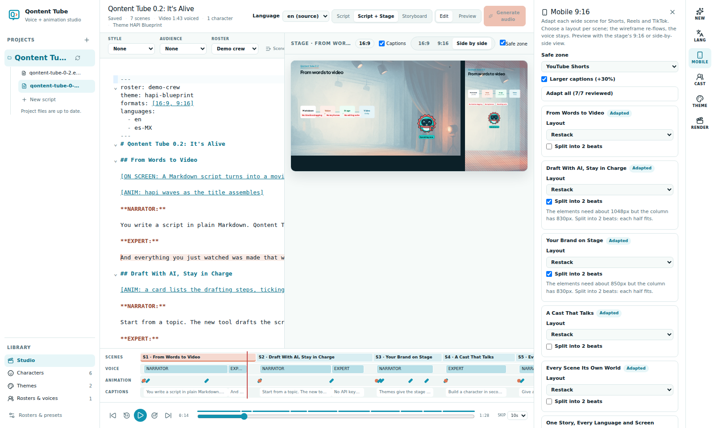

# Mobile and feed formats

Publish vertical and feed videos from the same script. The **MOBILE** tool adapts each wide scene to two portrait formats; the wireframe re-flows, **the voice stays**:

| Format   | Size        | Plays best on                           |
| -------- | ----------- | --------------------------------------- |
| **9:16** | 1080 × 1920 | YouTube Shorts, Instagram Reels, TikTok |
| **4:5**  | 1080 × 1350 | Instagram, Facebook, and LinkedIn feeds |

Each format has its own layouts, so a scene can restack in 9:16 and letterbox in 4:5. Changing one never changes the other, and the 16:9 storyboard stays the source of both.

## Turn on 9:16

Open **MOBILE** and choose **Add 9:16 to this script's formats**. Each scene then gets a vertical layout:

| Layout         | What it does                                                                                                                                                                         |
| -------------- | ------------------------------------------------------------------------------------------------------------------------------------------------------------------------------------ |
| **Restack**    | Stacks the scene's elements vertically. **Split into 2 beats** shows what the narration introduces first, then switches to what comes later in the scene; characters stay on screen. |
| **Focus crop** | Zooms the wide stage onto one element.                                                                                                                                               |
| **Letterbox**  | Shows the wide stage between a title band and the captions.                                                                                                                          |

Scenes start with an automatic layout and the **Needs review** badge. When an element will not fit — for example "the flow is wider than 9:16" — MOBILE explains why and suggests a layout. **Apply** accepts one suggestion; **Adapt all** accepts every scene.

## Safe zones and captions

Choose **YouTube Shorts**, **Instagram Reels**, or **TikTok** to keep captions and content clear of each platform's buttons and bars. The stage draws the zone over the 9:16 preview, and MOBILE warns when something reaches into it. **Larger captions** makes 9:16 captions 30% bigger.

## Preview

In **Script + Stage**, switch the stage to **9:16** or **Side by side**.

## Feed posts in 4:5

In MOBILE, switch to **4:5** and choose **Add 4:5 to this script's formats**. Scenes get the same layouts as in 9:16 (**Restack**, **Split into 2 beats**, **Focus crop**, **Letterbox**), with suggestions computed for the shorter frame. A wide 16:9 scene fits a 4:5 frame at full width with room for the title and captions, so for diagrams that are too wide to restack, MOBILE suggests **Letterbox** first.

- **Feed guide:** **Instagram profile grid** shows the 3:4 crop your profile grid uses and warns when content would be cut. 4:5 has no platform buttons over the video, so the 9:16 safe zones don't apply.
- **Larger captions** is set separately for 4:5.
- **Preview:** switch the stage to **4:5**, or **Side by side** to see 16:9 beside every portrait format the script uses.
- **Render:** in **RENDER**, choose **4:5 · 1080 × 1350**. A feed video is always one file; it's never split into parts. Feeds usually autoplay muted, so consider **Show caption bubbles in the picture**.

## Render and split into parts

In **RENDER**, choose **9:16 · 1080 × 1920**. **Split into parts under 60 s** also writes numbered parts, cut at scene boundaries, each starting with a "Part n of N" card. MOBILE lists the planned parts and flags scenes longer than 59 seconds on their own.
