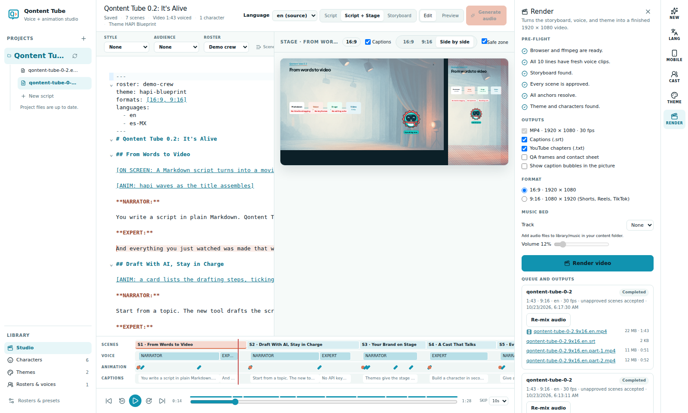

# Rendering videos

The **RENDER** tool turns the storyboard, voice, and theme into a finished video on your computer, using Chrome, Chromium, or Edge and ffmpeg that you already have. Rendering is available in the desktop app and local server.

These tools are not bundled. Rendering requires ffmpeg 5 or later with `libx264` and AAC, plus a Chromium-family browser. The browser captures animation frames; ffmpeg handles media conversion, video encoding, audio mixing, and final muxing. Voice-only authoring and playback do not require them. Review all [requirements before you buy](./requirements).

## Pre-flight

Before rendering, a checklist confirms that the render tools are ready, every line has fresh voice, a storyboard exists, scenes are approved, anchors resolve, and the theme and characters are found. Warnings can be confirmed; your confirmation is recorded with the job. Without voice, choose **Render an animatic** for estimated timing and silence.

## Frame rate

**Frame rate** in RENDER sets how many frames per second the video has. 30 fps is the default and suits most videos. Animation, narration, and captions keep their timing at any rate; only the smoothness and the render time change.

| Rate | Use it for                                                                        |
| ---- | --------------------------------------------------------------------------------- |
| 5, 8 | Quick drafts and GIF-like loops. Renders fastest; motion steps visibly.           |
| 12   | A stylized look, like hand-drawn animation. Renders in under half the time of 30. |
| 24   | A cinematic feel.                                                                 |
| 30   | The default for YouTube, social video, and product demos.                         |
| 60   | The smoothest camera pans and scrolling. About twice the render time of 30.       |

Screen recordings are captured at 30 fps, so at 60 fps recorded footage repeats frames while animation and camera moves still gain smoothness.

## Outputs

- **MP4** · 1920 × 1080, 1080 × 1920 for 9:16, or 1080 × 1350 for 4:5 · 30 fps by default
- **Captions** (`.srt`)
- **YouTube chapters** (`.txt`)
- **QA frames** and a contact sheet
- Optional caption bubbles in the picture and a looped **music bed** from `library/music/`
- **9:16 parts** under 60 seconds (see [Mobile and feed formats](./mobile-formats))

Files are saved in `renders/<project>/` in your content folder; earlier files are kept with a timestamp.

## Capture scenes

Capture problems block a render with no override, and each render with captures also writes `<name>.render-metadata.json`. See [Validate and approve](./validate-and-approve). Render jobs copy the media they use, so replacing a file later can't change a job.

## Queue

Renders run in parallel chunks with progress and time remaining. **Cancel** and **Retry** resume from finished chunks. **Re-mix audio** updates the voice or music without rendering the picture again. Play finished videos right in the app.

If the tools are missing, the setup checklist shows install commands for Windows, Ubuntu/Debian, and Fedora, or lets you point to custom paths.
