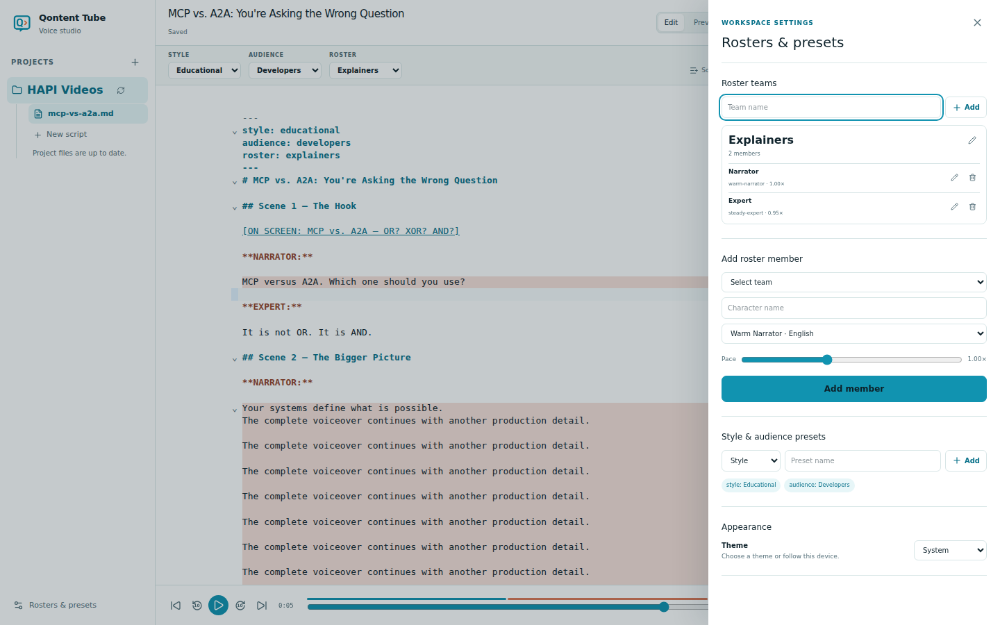

# Build rosters and choose voices

A roster is a reusable cast for a show, channel, course, campaign, or story. It keeps speaker names, voices, and pacing consistent across scripts.

## Create a roster

1. Open **Rosters & presets** from the lower-left corner.
2. Enter a team name and choose **Add**.
3. Add each narrator or character to that team.
4. Select the roster from the script toolbar.

Roster names must be unique. Member names also need to be distinct after normalization, which prevents two entries that would match the same speaker cue.

## Configure a member

For every member, choose:

- A character name that matches the standalone bold cue in Markdown
- A friendly voice from the available catalog
- A speaking pace from `0.7×` through `1.5×`

Qontent Tube keeps provider model identifiers behind the server boundary. The workspace only receives friendly, provider-neutral labels and traits.

Changing a member's voice or pace makes affected narration outdated because it would no longer represent the active cast. Regenerate only those passages when you are ready.

## Voice a character yourself

A character can be you instead of an AI voice. Edit the member and choose **You · camera + mic** under **Who voices this character**. Rosters are shared, so this applies to every script that uses the roster; your recordings stay with each script.

- **Your lines show their state** in the script, the outline, and the timeline, always as a word as well as a color: _To record_, _Recorded · take 2_, _Outdated · line edited_ (you changed the words after recording), _Needs review_, or _Recording unavailable_ (in the hosted app).
- **The header counts what is left:** `Generate audio · AI lines` voices everyone else, and `Record my lines · 2 left` shows your remaining lines and opens the [teleprompter](./record-your-lines) on the first one.
- **AI stand-in voice:** until you record, your lines can play in the member's AI voice, so playback and timing have no gaps. It is labeled _stand-in voice_ everywhere, and the stage shows your picture-in-picture bubble marked _Not yet recorded_. Turn it off and those lines stay silent and are never sent for synthesis.
- **Edits are followed safely.** A take stays with its words when you add, move, or rename scenes. If you change the words, the line becomes _Outdated_ and the old take is kept for comparison. If the same words appear more than once and Qontent Tube cannot tell which line a take belongs to, it asks you: **Use for** one of them, or **Keep as history**. It never guesses by position.
- **Rendering with stand-ins** asks you to confirm a draft, and the render records how many of your lines used the stand-in. The publish composer shows _Uses an AI stand-in for N of your lines_ on that video.
- **Translations are dubbed:** in a translated script, your lines use your character's voice for that language.

Your recordings stay on your computer, under the content folder, named by their content. They are never sent to a voice or AI provider.

## Use style and audience presets

Style and Audience are reusable organizational metadata. They are useful for keeping a library consistent, but they do not transform the script, select a voice, or alter generation.

## Appearance and application settings

The same settings drawer contains Light, Dark, and System appearance choices. Packaged desktop builds also expose local content storage, voice credential status, and the explicit **Quit Qontent Tube** action.
