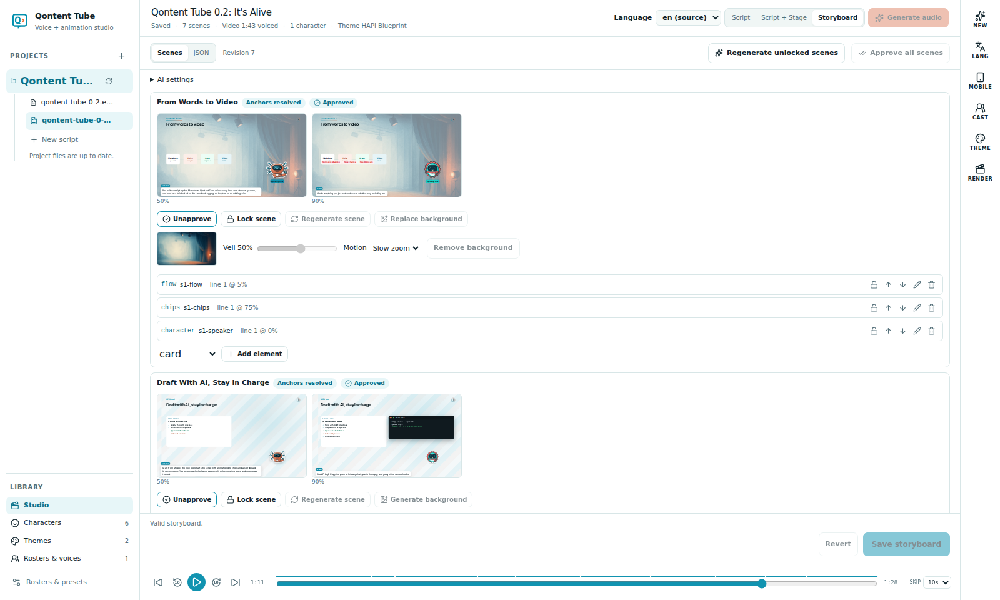

# Storyboards

A storyboard is the animation of a script, saved as a JSON file next to it (`intro.md` → `intro.storyboard.json`). It is data, never code, so it is always safe to open, edit, and share. The **Storyboard** view is where you shape it.

## Scenes and elements

Each scene shows two **wireframes** — the stage at 50% and 90% of the scene — and its list of elements. Fifteen element kinds cover most explainers: title, text, card, chips, terminal, code, flow, stack, bars, table, image, pill, banner, character, and pip (Picture-in-Picture).

- **Add element** picks a kind and adds it with sensible content. For **image** and **pip**, the media picker opens first, and the element is added once you choose something.
- **Edit** opens a form for that kind. Fields, lists, and choices come from the element's schema.
- Move elements up or down, or remove them.
- The **JSON** tab shows the same storyboard as text, validated as you type.

Scenes can also have a `subtitle` under the title and a small `brand` mark in the corner, shown in 16:9. To show a real screen in a scene, see [Capture scenes](./capture-scenes).

## Images and Picture-in-Picture

Images and recordings come from your [assets](./files-and-storage). You choose them in the media picker; you never type a source.

- **Image** shows a picture: a built-in image, a **screenshot** from a capture, an **upload**, or an **AI-derived** or **AI-drawn** image. To change it, open the element and click **Change…**.
- **Picture-in-Picture** (`pip`) plays a **capture** take or an uploaded **recording** in a framed inset, the way a presenter sits in a corner. Like a character, it takes a slot (bottom-right by default) and has:
  - a **size** (sm, md, lg) and a **shape** (rounded or circle);
  - **fit** (cover crops, contain letterboxes);
  - an **entrance** (pop, slide, fade) and an optional **label**.

  Playback starts when the PiP enters and follows the stage clock exactly, in preview and render. **Trim** picks the part to play, in milliseconds. When the recording ends before the PiP leaves, it **holds** its last frame or **loops**.
- **A PiP is always muted.** The narration stays the only sound; the recording's own audio never reaches the video.

The media picker lists the project's and global assets of the right kind, with thumbnails, size, duration, and privacy state. It can search, filter by source, and **Upload…** a new file. A capture marked **Needs recapture** can't be chosen. An unreviewed capture can be chosen, but it carries a reminder to review its privacy.

Each element remembers the exact file it shows, by hash:

- If an asset is replaced, the element shows **Media changed** instead of different pixels. **Use new version** accepts the new file. Until you do, a render stops with the scene and element named.
- A missing asset shows **Media missing** with **Choose another**.
- An asset in use can't be deleted.

Images from assets and PiPs need the v3 storyboard format: adding one upgrades the draft automatically, and older storyboards keep working. AI drafting and regeneration never add or change them. A regenerated scene keeps them as they are, like locked elements. An image embedded in a storyboard as a `data:` URI (from an older file, pasted JSON, or an API client) moves to the project's assets when you save. The element then points at the asset, which keeps the storyboard small and readable, and the image becomes reusable like any other asset. The same image saved again reuses its asset (**Embedded image** plus a short hash). Scene brand marks stay as they are.

## Anchors: when things appear

Every element has an **Enters** anchor (and optionally **Leaves**): a dialogue line of the scene, shown with its speaker and text, and a fraction of that line. "Line 2 at 50%" means halfway through the second line. Items inside cards, chips, flows, and tables can have their own anchors to appear one by one as the narration mentions them.

If you edit the script and a line moves or disappears, the affected scenes are marked **Needs review**. Nothing is deleted.

## Light or dark scenes

**Look** on a scene card sets the scene to the light or dark version of your theme; save the storyboard to keep it. Regenerating a scene keeps the look you chose.

## Hide a scene's title

If a scene's title overlaps what you put on the stage, clear **Show scene title** on its card and save the storyboard. The tag, title, and subtitle are hidden in every format, and a title element of your own can use the space at the top instead.

## Video look

**Look** in the storyboard toolbar decides how the whole video looks and moves on top of its theme: type (sans, sans with monospace labels, or monospace), scene transitions (soft, cut, fade, slide, wipe, blur), background texture, pace, and the **chrome** every scene shares: a kicker such as `STEP {n} · {sceneTag}`, step progress (ring, dots, or bar), a footer line, and a `03 / 07` counter.

- Pick a preset: Default (today's look), Editorial, Blueprint, Lab Protocol, or Midnight Console.
- **Propose looks** asks AI for two or three looks with a reason each, previewed on your first scene; nothing changes until you choose one and save the storyboard.
- Adjust the main choices, then **Save preset** for this project or for every project.
- **Show chrome** on a scene card hides the chrome on that scene (an end card, say); progress then counts only the scenes that show it.

Scene drafting and regeneration follow the look and never draw chrome themselves. Rich animations read it too, and keep clear of the chrome and captions. A storyboard with a look is saved as `qontent-tube/storyboard@3`.

## Review: approve and lock

- **Approve** a scene when its wireframe looks right. **Approve all scenes** in the toolbar approves every scene at once.
- **Lock scene** or lock a single element to protect it.
- **Regenerate scene** makes a candidate you review beside the current scene; **With guidance…** adds an instruction, an approach, and a visual reference. See [Guided scene regeneration](./guided-regeneration). **Regenerate unlocked scenes** asks AI for new elements in every unprotected scene at once ([AI drafting](./ai-drafting)). Approved and locked scenes are never replaced, and locked elements stay exactly as they are.

The RENDER tool's checklist updates as soon as you approve, so you can see the moment everything is ready.

## Scene backgrounds

**Generate background** gives a scene its own picture behind the cards.

1. Qontent Tube suggests a prompt built from the scene's lines and directions and your theme's colors, with rules that keep text and foreground figures out of the picture and the card areas calm. Edit it as you like.
2. Choose a quality: **Fast** (about 10–20 seconds), **Balanced** (20–40 seconds), or **Best** (40–90 seconds, several times the cost).
3. **Generate background**, or **Copy prompt** and **Upload image** if you prefer another tool (PNG, JPEG, or WebP up to 6 MB).

The picture fills the stage under a theme-colored **veil** (0–90%) so every word stays readable, with a slow **zoom**, **pan**, or **still**. Change the veil and motion from the scene card, or remove the background.

Backgrounds need an image service: connect one in **Settings → Scene images** (OpenAI-compatible, `gpt-image-1` by default). If AI assist already uses an OpenAI key, it is reused. Only the prompt is sent.

The image account and any provider charges are yours. No image key is required when you use **Copy prompt** and upload the result manually. See [Requirements before you buy](./requirements).
