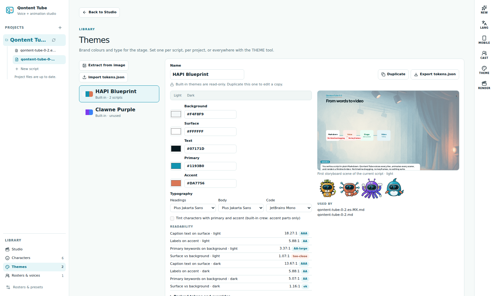

# Themes

A theme gives the stage your brand: background, surface, text, primary, and accent colors for light and dark scenes, fonts from your font library, and **Skills**: your design rules for AI. Qontent Tube derives every other stage color from those roles, so changing one color restyles everything consistently.

## Create and edit

**Library → Themes** lists the built-in themes (read-only) and yours.

- **Duplicate** a built-in theme or create a new one.
- Each theme has three tabs: **Colors** (the roles for light and dark scenes and, if you need, individual tokens), **Fonts**, and **Skills**. Use the arrow keys to move between tabs.
- The live preview shows your current script's first scene and the crew in the theme.
- **Extract from image** proposes a palette from a logo or screenshot, entirely on your computer.
- **From brand colors** builds a whole theme from one brand color (and an optional accent). Choose **Mostly light** or **Mostly dark** scenes and one of three variations: **Calm** (quiet surfaces, the brand on accents), **Bold** (the brand on panels), or **High contrast** (text at 7:1 or more; tint labels in dark scenes at 4.5:1). Every text is readable by construction. The preview shows each variation on the stage; nothing is saved until you choose **Create theme**, and you can fine-tune it afterwards.

## Readability

Each theme is graded against WCAG contrast (AA needs 4.5:1 for normal text) for captions, labels on accent colors, and keywords, and surfaces too close to the background are flagged.

**Text on each surface** grades every background a scene can use (page, paper, panel, dark background, primary and accent fills, and their tints) against its own text and muted text, in light and dark scenes. Every background has its own text color: a dark panel gets light text automatically, so text on it stays readable in light and dark scenes alike. You can override any of them under **Derived tokens and overrides**.

These are warnings: you can save a theme that has them. **Fix…** shows the color it proposes (only the lightness changes, so the hue stays yours) and the new ratio; **Apply** makes the change, **Cancel** leaves the theme as it was. Colors that only dark scenes use (primary and accent fills and their tints) are fixed by changing the dark colors.

**On the stage** previews the theme on real stage components and a built-in template, each in a light and a dark scene, and updates as you edit.

## Fonts

The **Fonts** tab of a theme picks a family for headings, body text, and code, and the heading weight. The family lists are grouped into **Bundled** and **Yours**; the weight list only offers weights the heading family has. A specimen shows the three fonts as the stage draws them, and the previews update as you choose.

If a theme names a family that is no longer in the library (for example, a theme imported from someone else), it still works: that role draws with its generic fallback, and the tab says which family to add.

### The font library

Switch the Themes page to **Fonts** (or choose **Manage fonts** on a theme) to see every family themes can use, with a specimen at each weight and the themes that use it.

- **Bundled** families ship with the app and are read-only: Plus Jakarta Sans, JetBrains Mono, Inter, Source Serif 4, Bricolage Grotesque, and Fira Code (all SIL Open Font License).
- **Add a font family** uploads your own: WOFF2, WOFF, TTF, or OTF files, either one variable file or a file per weight and style (at most 4 MB per file, 16 MB and 12 files per family). The family name, weights, and style are read from the files; check them before saving. You confirm that you have the right to use the font in videos.
- **Edit** renames a family, changes its fallback, source, or license note, and adds or removes files.
- **Delete** works only when no theme uses the family; otherwise it lists the themes to change first. Files no other family uses are removed.

Fonts are stored with your content (`library/fonts/`) and never load from the internet: previews, animations, and renders all use the stored files. A render waits until every font is loaded before its first frame. Animations embed the theme's fonts up to 6 MB in total; a family over that is drawn with its fallback in animations, and the Fonts tab says so.

## Skills

The **Skills** tab is a Markdown document of your design rules, organized by `##` sections, that AI follows whenever it works with this theme. A new theme starts with these sections, each with a hint in `<!-- -->` that is never sent to AI:

**Do's**, **Don'ts**, **Typography**, **Layout**, **Color usage**, **Motion** (moves, timing, easing), **Diagrams**, **Illustrations and icons**, **Data and charts**, **On-screen copy**, and **Brand terms**.

Rename, remove, or reorder them, or add your own with **Add section**. The **Skills** panel beside the editor lists the sections, like the scenes outline of a script: select one to jump to it. A filled dot means the section has instructions; the chips under it show which AI tasks receive it.

| Section | Reaches |
| --- | --- |
| Do's, Brand terms | Storyboard drafting, scene regeneration, rich animations and edits, template fills, illustrations |
| Don'ts | All of the above, and AI frame review |
| Typography, Layout | Storyboard drafting, scene regeneration, rich animations and edits |
| Color usage, Diagrams | The same, and illustrations |
| Motion | Scene regeneration, rich animations and edits |
| Illustrations and icons | Scene regeneration, rich animations and edits, illustrations |
| Data and charts | Storyboard drafting, scene regeneration, rich animations and edits, template fills |
| On-screen copy | Storyboard drafting, scene regeneration, template fills |
| Your own sections | Every visual task: storyboard drafting, scene regeneration, rich animations and edits, template fills, illustrations |

Skills are preferences, not overrides: the app's own rules (the output format, safe areas, theme surfaces and contrast, theme colors instead of literal ones, nothing loaded from the internet) always win. The editor warns about instructions AI will not follow, such as a literal color (`#FF0000`), a web address, or "ignore the previous rules". Warnings never block saving.

- **Show what AI receives** shows, for each task, the exact text it will get. Each task has a budget (6,000 characters; 3,000 for template fills and frame review). When the sections for a task are longer, they are included in order (Don'ts, Do's, the task's own sections, then yours) and the preview names the ones left out.
- **Export .md** saves the Skills as a Markdown file; **Import .md** previews which sections it will replace or add, and changes nothing until you apply it.
- Built-in themes ship short starter Skills (Do's, Don'ts, Motion, Diagrams). Like the rest of a built-in theme they are read-only; **Duplicate** the theme to edit a copy.

Each AI result records the theme and a fingerprint of the Skills it received, in its provenance.

## Where a theme applies

The **THEME** tool applies a theme to the **script**, the **project**, or **everywhere**, and shows which one is active. The most specific wins: script, then project, then the global default.

Optional **character tinting** lets the crew's accent parts take the theme's colors.

## Import and export

Export a theme as `tokens.json` (Design Tokens format) or import one. The export includes the font families and the heading weight. When an imported file names a font that is not in your library, the role uses the default font and a notice says which family to add. Deleting a theme that is in use asks which theme replaces it.

Theme files are saved in a new version (`qontent-tube/theme@2`) that adds fonts from the library and Skills. Themes saved by earlier versions open as before and are upgraded when you save them; earlier versions of the app skip themes saved in the new version.
