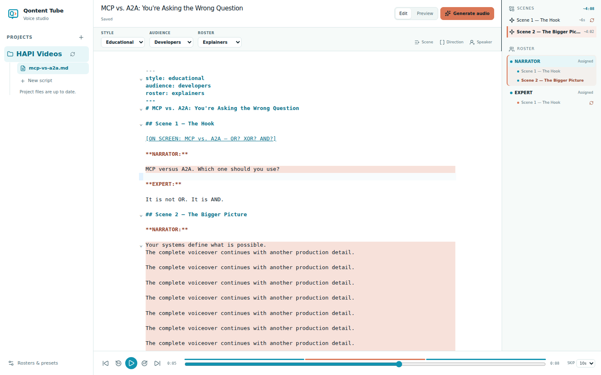
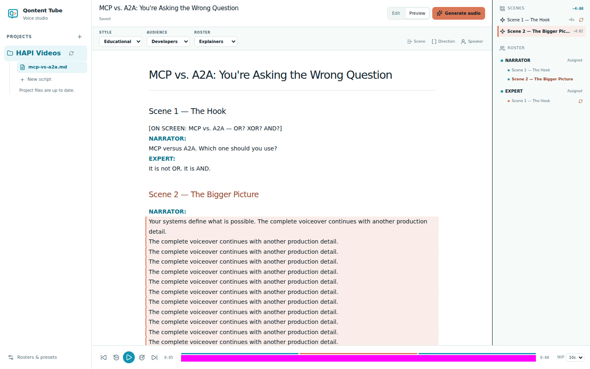

Generar una voz es fácil. Gestionar una locución completa sigue siendo sorprendentemente complicado.

El guion vive en un lugar, las voces elegidas en otro, y cada párrafo se convierte en otro archivo que nombrar y ubicar. Reescribe una frase y toda la producción vuelve a sentirse incierta.

**Qontent Tube mantiene el guion en el centro de ese trabajo.**

{/* truncate */}

## Los videos sin rostro nunca deberían sentirse sin voz

Qontent Tube convierte un guion estructurado en Markdown en una producción organizada con varias voces. Reconoce escenas y hablantes, los conecta con un elenco reutilizable, estima la duración, genera la narración al alcance que elijas y reproduce el resultado como una línea de tiempo continua.

Escribe la historia. Asigna las voces. Pulsa reproducir.

## Un formato de guion que puedes conservar

Las convenciones de escritura son deliberadamente pocas:

```markdown
# Why Great Ideas Never Leave the Notes App

## Scene 1 — The unfinished idea

[ON SCREEN: A phone filled with half-written notes.]

**NARRATOR:**

You probably do not need more ideas. You need a better way to finish the ones you already have.
```

Los encabezados de escena dan forma al esquema. Las marcas de hablante en negrita identifican quién habla. Las indicaciones entre corchetes guían lo visual sin ser locutadas. La fuente sigue siendo Markdown común que puedes editar dentro o fuera de Qontent Tube.

## Elige el elenco una vez y sigue creando

Un roster reutilizable mantiene juntos la voz y el ritmo de cada narrador o personaje. Un narrador de documental puede seguir siendo reconocible de un episodio a otro. Un elenco de ficción puede mantenerse coherente durante toda una historia.

El roster también hace visibles los problemas de estructura antes de generar. Si un hablante del guion no coincide con un miembro configurado, Qontent Tube lo señala en lugar de adivinar.

## Mira la producción antes de generarla

El espacio de trabajo convierte el guion en un esquema de escenas y hablantes. Puedes saltar a una escena, encontrar cada pasaje de un hablante y usar las duraciones estimadas para revisar el ritmo antes de crear el audio.



## Genera lo que cambió

El primer borrador generado es útil. La quinta revisión es donde el flujo de trabajo más importa.

Qontent Tube registra si la narración está lista, falta, falló o está desactualizada. Si cambia una frase, una voz o un ritmo, solo el pasaje afectado necesita audio nuevo. Los clips sin cambios siguen listos y en orden.

## Escucha una historia continua

Los pasajes generados se convierten en una sola línea de tiempo de reproducción. Reproduce, pausa, desplázate, salta o muévete entre clips mientras la escena activa y el texto locutado permanecen resaltados.



Ese contexto importa. Una carpeta de clips te dice qué se generó; una línea de tiempo ligada al guion te dice cómo se siente la historia.

## Hecho para el cambio, sin caos

Qontent Tube nació de una frustración práctica: crear videos sin rostro con varios narradores y personajes significaba gestionar demasiados archivos de audio desconectados. Cada pequeña mejora del guion provocaba otra ronda de búsquedas y reconstrucciones.

Queríamos que el guion siguiera siendo el corazón de la producción, que las voces recurrentes se sintieran como un elenco y que revisar fuera lo bastante seguro como para que los creadores sigan mejorando la historia.

Esa es la idea detrás de Qontent Tube:

**Un guion. Un elenco. Una historia continua.**

[Crea tu primera locución](/docs/getting-started) o lee la [guía de guiones en Markdown](/docs/writing-scripts).
