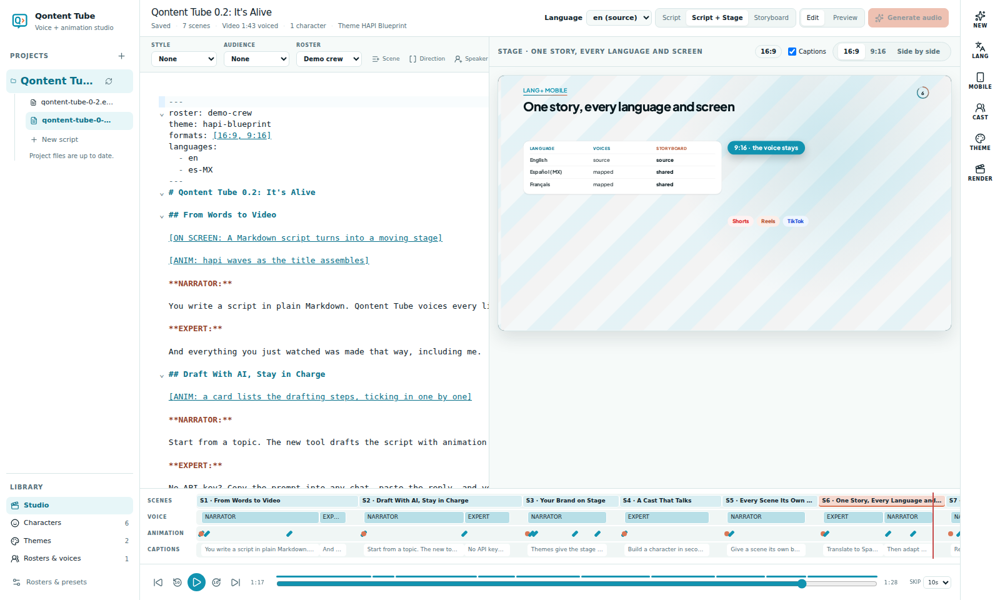
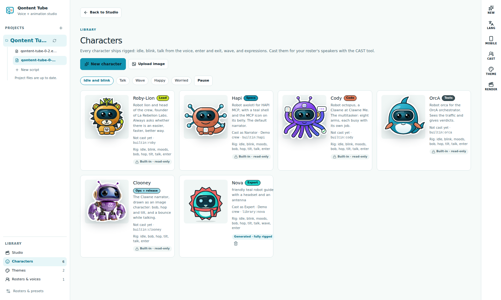
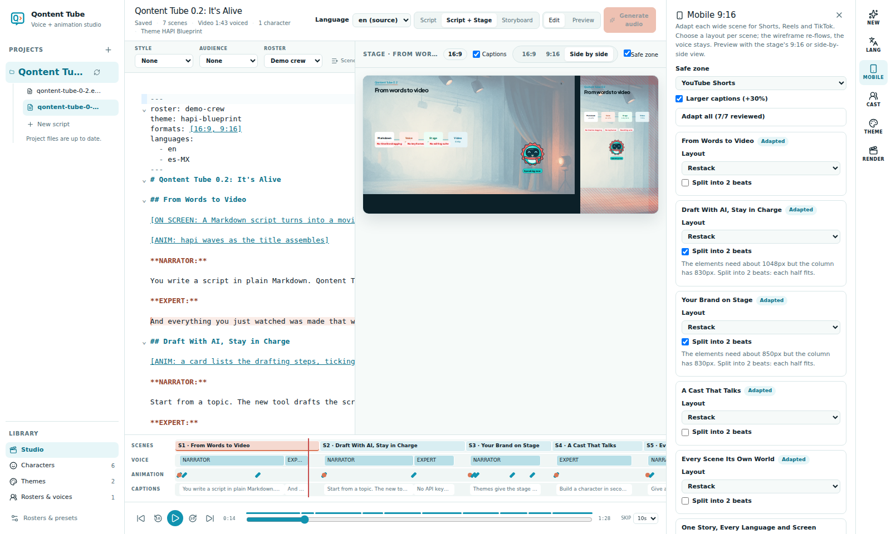

En 0.1, Qontent Tube le dio una voz a tu guion. En 0.2, le da un escenario.

Escribe las escenas. Escucha al elenco. Mira cómo las tarjetas entran justo en la palabra que las menciona, los personajes hablan con la voz real y el MP4 terminado llega a tu carpeta: en inglés, en español y como Shorts.

**El video de abajo se hizo por completo con Qontent Tube 0.2.** Un guion en Markdown, un storyboard, dos voces, un elenco de dos personajes, tres fondos pintados y tres renders: este, una versión en español y un Short vertical.

<video
  controls
  preload="metadata"
  poster="/img/v020/demo-poster.jpg"
  style={{ width: "100%", borderRadius: 12 }}
>
  <source src="/video/qontent-tube-0-2-demo.mp4" type="video/mp4" />
  <track
    kind="captions"
    src="/video/qontent-tube-0-2-demo.en.vtt"
    srcLang="en"
    label="English"
  />
</video>

{/* truncate */}

## De las palabras al video

Studio ahora tiene tres vistas del mismo borrador: **Script**, **Script + Stage** y **Storyboard**. El escenario es un video animado de 1920 × 1080 cuyo ritmo viene de la voz. Cada momento está anclado a una línea ("línea 2 al 50 %"), nunca a una marca de tiempo, así que cuando reescribes una frase o regeneras un clip, la animación simplemente la sigue.

¿Aún no tienes voz? Pulsa **Preview with estimated timing** y mira el video completo con un ritmo calculado por número de palabras.

## Storyboards en los que puedes confiar

Un storyboard es un archivo JSON junto a tu guion: datos, nunca código generado. Catorce tipos de elementos (tarjetas, etiquetas, flujos, terminales, tablas, barras, personajes…) con editores de formulario, wireframes al 50 % y al 90 % de cada escena, y un flujo de revisión: **approve**, **lock**, **Approve all scenes**. Edita el guion y las escenas cuyas líneas se movieron quedan marcadas como _Needs review_. Nada desaparece en silencio.

## Redacta con IA, mantén el control

La herramienta **NEW** convierte un tema en un guion y un storyboard completo. Usa tu propia clave de Anthropic u OpenAI (o cualquier servidor compatible con OpenAI, como Ollama), elige el modelo y el esfuerzo, y sabe qué esperar: _Fast_ para primeros borradores en menos de un minuto, _Thorough_ para guiones largos y cuidados. O prescinde de las claves: el **modo manual** muestra el prompt exacto para cualquier producto de chat y valida la respuesta que pegas.

Cada resultado es un borrador: se valida contra el esquema y el guion, se repara una vez automáticamente si hace falta, se registra con su procedencia y nunca sobrescribe tu trabajo.

## Tu marca en el escenario

Los temas dan al escenario tus colores y tipografías, evaluados según la legibilidad WCAG con correcciones de un clic. Extrae una paleta de tu logotipo, aplícala por guion, por proyecto o en todas partes, y expórtala como Design Tokens.

## Un elenco que habla

Crea personajes en el **Character builder**: descríbelos, elige un estilo (plano, 3D suave, línea, píxel) y una personalidad, genera cuatro variaciones, fija las que te gusten y refínalas con palabras. Cada personaje viene con su rig: respira, parpadea, saluda, tiene expresiones y **habla con la voz real**: Qontent Tube lee el volumen de cada clip 30 veces por segundo y la boca lo sigue.

Usa **CAST** para darle una cara a cada hablante. En la demo, nuestro Narrador es Hapi y la Experta es Nova, creados en segundos a partir de una frase.

## Cada escena, su propio mundo

**Generate background** pinta una imagen para una escena a partir de su historia y de los colores de tu tema, con las zonas de las tarjetas tranquilas y sin texto. Un velo del color del tema mantiene legible cada palabra, y un zoom o paneo lento le da vida. ¿Prefieres otra herramienta? Copia el prompt y sube tu imagen.

## Una historia, todos los idiomas

La herramienta **LANG** traduce un guion a un borrador vinculado (`intro.es-MX.md`) que conserva las mismas escenas, hablantes y storyboard, con sus propios textos en pantalla. Da a cada hablante una voz por idioma, protege términos con un glosario y deja que **Timing** ajuste la traducción al ritmo original. Cambia la fuente y solo se vuelven a traducir las líneas desactualizadas.

La versión en español de la demo se tradujo, se volvió a locutar y se renderizó en pocos minutos:

<video controls preload="metadata" style={{ width: "100%", borderRadius: 12 }}>
  <source src="/video/qontent-tube-0-2-demo.es-MX.mp4" type="video/mp4" />
</video>

## Y todas las pantallas

La herramienta **MOBILE** adapta cada escena a 9:16 (reapilar, dividir en momentos, recorte con foco o franjas) con las zonas seguras de YouTube Shorts, Reels y TikTok dibujadas en la vista previa. La voz sigue siendo la misma. Renderízala como un video vertical o en partes de menos de 60 segundos, cada una con una tarjeta "Parte n de N".

Esta es la parte 1 de la demo como Short, renderizada desde el mismo storyboard y la misma voz:

<video
  controls
  preload="metadata"
  style={{
    width: "100%",
    maxWidth: 360,
    borderRadius: 12,
    display: "block",
    margin: "0 auto",
  }}
>
  <source src="/video/qontent-tube-0-2-short-part-1.mp4" type="video/mp4" />
</video>

## Renderizado en tu computadora

**RENDER** ejecuta una lista de comprobación previa y luego exporta un MP4 a 30 fps con subtítulos (`.srt`), capítulos de YouTube y fotogramas de control de calidad, usando el Chrome y el ffmpeg que ya tienes. Los renders se ejecutan en fragmentos paralelos, pueden cancelarse y reanudarse, y el audio puede remezclarse sin volver a renderizar la imagen. Tus guiones, voces y videos se quedan en tu máquina.

## Empieza

- Lee las nuevas guías, empezando por [Studio and the animated stage](/docs/studio-and-stage).
- ¿Ya usas 0.1? Tus guiones, rosters y audio siguen funcionando; 0.2 solo añade.

Escríbelo. Escúchalo. Publícalo.
