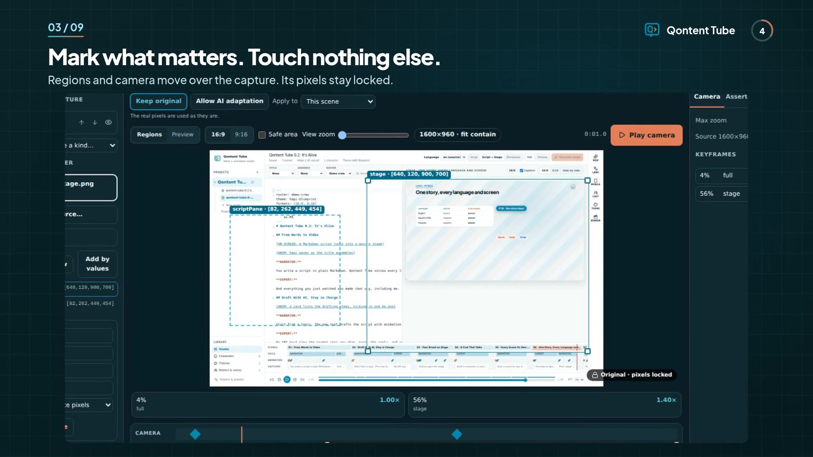
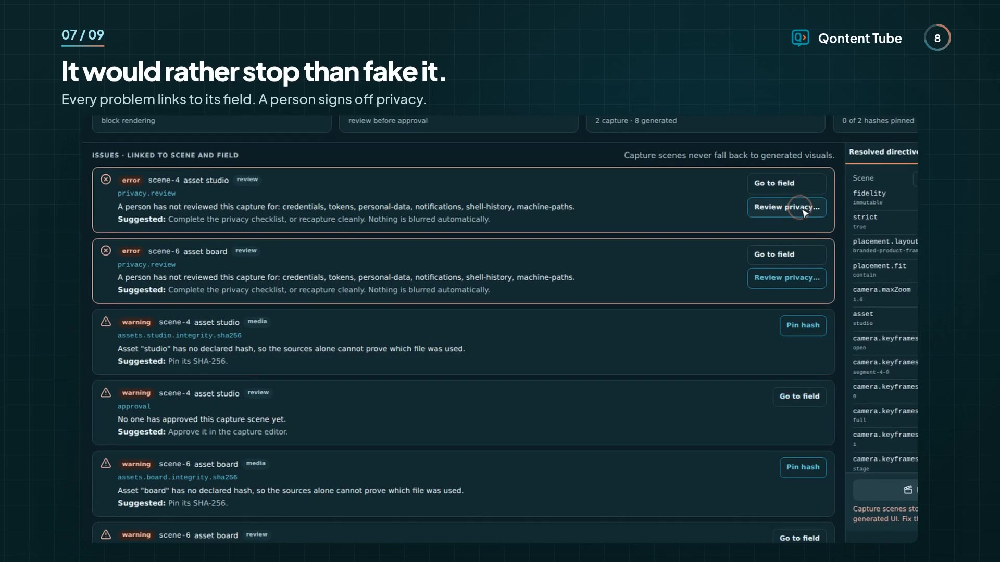
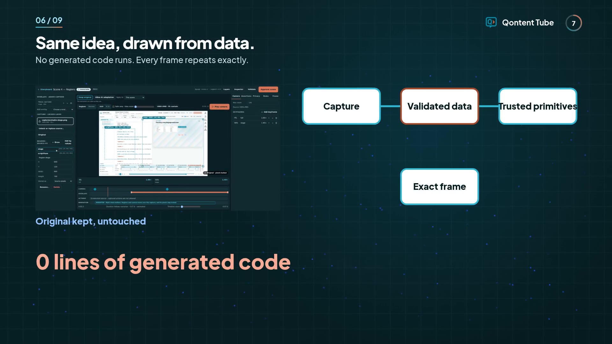
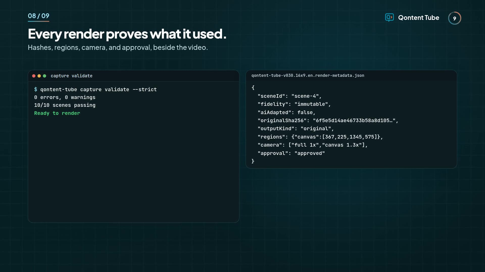

Pide a una IA una demo de producto y obtendrás un video de un producto que no existe. La pantalla parece verosímil, pero no es la tuya. No puedes decir qué versión muestra, y nadie puede comprobarlo.

Qontent Tube 0.3 empieza por el otro extremo. **Tus capturas y grabaciones reales se quedan exactamente como se capturaron, y la animación hace la explicación a su alrededor.**

**Hicimos así nuestro video de lanzamiento.** Es la app grabándose a sí misma, en el proyecto que produjo el video. Incluso puedes ver la película dentro de su propia vista previa.

<video
  controls
  preload="metadata"
  poster="/img/v030/launch-poster.jpg"
  style={{ width: "100%", borderRadius: 12 }}
>
  <source src="/video/qontent-tube-v030.16x9.en.mp4" type="video/mp4" />
</video>

{/* truncate */}

La escena animada no necesitó una clave de API. Esto es lo que hicimos a propósito, para que puedas juzgarlo con justicia:

- **Cuando no hay narración.** El video usa titulares y música, y el ritmo viene del número de palabras. **Añade una voz** y el ritmo la sigue.
- **Las grabaciones se aceleraron** de 1.4× a 2.3× antes de importarlas, para que encajaran en cada escena.
- **La grabación y la revisión se automatizaron con un script** para poder repetirlas. Eso incluye el puntero en pantalla, que dibuja nuestro script, y la aprobación de privacidad, ya que el material solo muestra un proyecto de demostración. Los mismos pasos funcionan a mano en la app.
- **La música es sintetizada**, no licenciada.

## Usamos nuestras propias demos

Creé el video de lanzamiento con el propio Qontent Tube 0.3, capturando nuestras pantallas reales y animando a su alrededor. Esto nos ayudó a detectar problemas que no aparecerían en una demo generada solo con IA.

Por eso usamos nuestras propias demos: para asegurarnos de que lo que presentamos es fiel a la realidad.

## Píxeles en los que puedes confiar

Importa una captura de pantalla o una grabación, y se verifica a partir de sus bytes y se le calcula un hash. Luego dirígela: dibuja regiones con nombre, mueve la cámara y añade contornos de foco y anotaciones en una capa superior. El escenario solo puede recortar, escalar y desplazar con una escala uniforme. No puede redibujar tu pantalla.



Cada movimiento de cámara está anclado a una línea de diálogo, no a una marca de tiempo. Reescribe la línea y la cámara la sigue.

## Prefiere detenerse antes que fingir

Una captura defectuosa no se convierte en silencio en otra cosa. **Validate & render** vincula cada problema con su campo y ofrece una corrección de un clic solo cuando la corrección no pierde nada. Los errores bloquean el render, sin excepciones.

Una persona aprueba la privacidad, porque no vamos a fingir que el software puede detectar todos los secretos en pantalla. La aprobación está ligada a hashes, así que cambiar la fuente la anula.



## IA cuando tú la eliges

Algunas ideas no tienen una pantalla que capturar. **Allow AI adaptation** hace que una escena sea elegible y no envía nada. Luego eliges qué enviar, solo para esa ejecución, y obtienes una propuesta para comparar con tu original. Solo se renderiza después de que la aceptes y la apruebes.

Una animación son datos dibujados por primitivas de confianza, así que no se ejecuta código generado, y la misma semilla da los mismos fotogramas. Los resultados generados se guardan, así que volver a renderizar nunca vuelve a llamar a un proveedor.



## Si haces videos por primera vez

No necesitas un editor de línea de tiempo, un diseñador de movimiento ni el presupuesto de un patrocinador. Necesitas un guion y tu producto en pantalla:

1. Escribe un guion corto en Markdown.
2. Graba tu pantalla.
3. Impórtala, marca lo importante y valida.
4. Renderiza en tu propia computadora.

Tu video sigue siendo original porque está hecho de tu trabajo, y renderizar no cuesta nada por minuto. Solo pagas los servicios que elijas, como una clave de voz. [Sigue el flujo de trabajo](/docs/product-demo-workflow).

## Si ya eres experto

Todo lo que hace el editor es un archivo comparable que conserva tus comentarios y el orden de las claves, así que puede vivir en tu repositorio junto al guion:

```yaml
scenes:
  scene-4:
    asset: regions
    camera:
      maxZoom: 1.6
      keyframes:
        - {
            id: canvas,
            at: { segment: segment-4-0, f: 0.4 },
            region: canvas,
            zoom: 1.3,
          }
```

Compruébalo en CI sin iniciar la app. El comando termina con un código distinto de cero ante problemas bloqueantes, y `--json` devuelve el mismo informe que la app:

```bash
qontent-tube capture validate --project launch --script tour.md --strict --json
```

Cada render escribe metadatos que registran lo que usó, con hashes y sin rutas ni claves:



## Versiona tu trabajo

Qontent Tube mantiene tus guiones, storyboards y capturas versionados junto a tu proyecto. Cada render escribe metadatos con hashes, así que puedes saber exactamente qué se usó y cuándo. La reproducibilidad viene incluida, y también un historial claro de cada cambio.

Llamamos a este enfoque **Video as Source**: una nueva forma de hacer video que hemos definido, donde un documento o guion es la fuente de verdad y el video es un artefacto de compilación. Escribes el guion, lo apuntas a tus capturas reales y el video se genera a partir de ellas. Edita la fuente, vuelve a compilar el video.

Los equipos de software ya trabajan así. DevOps tiene Infrastructure as Code, y los equipos de documentación tienen Docs as Code. Al video le faltaba esa pieza. Con Video as Source, tu guion se versiona, se revisa en un pull request, se comprueba en CI y se renderiza bajo demanda, y siempre coincide con el producto que muestra.

Hacer cine primero con capturas es nuestra forma de trabajar: el contenido real va primero, y la adaptación con IA o la animación vienen después, solo cuando tú lo eliges.

## Lo que sigue para ti

- Empieza con [Make a product demo](/docs/product-demo-workflow) y luego [Capture scenes](/docs/capture-scenes).
- ¿Ya usas 0.2? Tus guiones, storyboards y audio siguen funcionando. Las capturas son opcionales.

Primero la captura. Anima todo lo demás.
